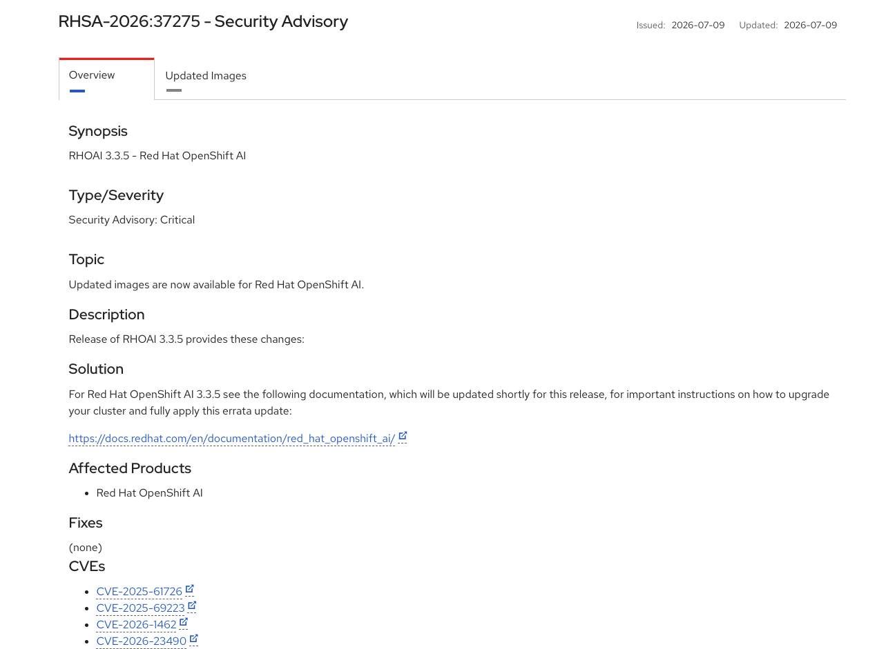
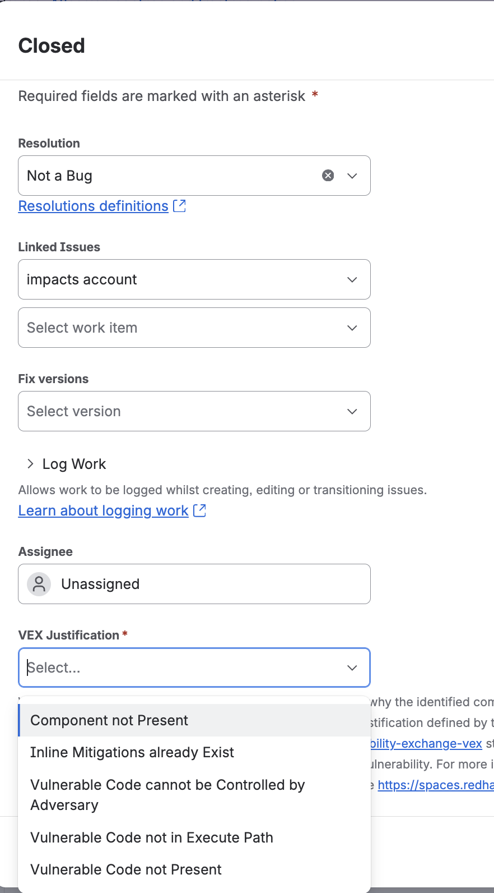

# Dealing with the CVEs {background-iframe="ambient/index.html"} 

# Part 1: Initial pearls of wisdom

## Addressing CVEs often feels like this:

{fig-align="center"}

## :hand: What is a CVE?

CVE (_Common Vulnerabilities and Exposures_) is an industry-wide reference code for specific known cybersecuirity issues. 

You can find more information about specific CVEs e.g. on:

- [GitHub Advisory Database](https://github.com/advisories)
- [National Vulnerability Database](https://nvd.nist.gov/)
- [CVE Program](https://www.cve.org/)
- [Red Hat CVE Database](https://access.redhat.com/security/security-updates)

## :tophat: Red Hat CVE Database

```{=html}
<iframe width="1500" height="700" src="https://access.redhat.com/security/security-updates/cve?q=&p=1&sort=updated+desc&rows=10&documentKind=Cve&products=Red+Hat+OpenShift+AI+(RHOAI)" title="Webpage example"></iframe>
```

## :tophat: Red Hat Products Errata

RH uses [this Tekton pipeline](https://github.com/konflux-ci/release-service-catalog/tree/production/pipelines/managed/rh-advisories) to create [a release wth an advisory](https://github.com/konflux-ci/release-service-catalog/tree/production/pipelines/managed/rh-advisories) to inform users about the present CVEs

::: {.fragment}
{fig-align="center" height="600"} 
:::

## :memo: CVE trackers on Jira

CVE trackers produced by the ProdSec will look like this:

::: {.fragment}
> CVE-2026-59885 rhoai/odh-trustyai-nemo-guardrails-server-rhel9: pyasn1: Denial of Service via crafted ASN.1 OBJECT IDENTIFIER [rhoai-3.3]
:::

::: {.fragment}
If you are an involved user, you should be cc'd on the ticket and you will get an email notifcation when the ticket is created
:::

::: {.fragment}
Alternatively, yoy might need a Jira query, e.g.

```bash
project = RHOAIENG AND text ~ "nemo-guardrails-server-rhel9" AND (summary ~ "CVE" OR labels = "CVE" OR issuetype = "Vulnerability") ORDER BY created DESC
```
:::

## :memo: Decomposing a CVE tracker

> <span style="color:red;">CVE-2026-59885</span> <span style="color:blue;">rhoai/odh-trustyai-nemo-guardrails-server-rhel9</span>: <span style="color:green;">pyasn1</span>: <span style="color:purple;">Denial of Service via crafted ASN.1 OBJECT IDENTIFIER</span> [<span style="color:orange;">rhoai-3.3</span>]

::: {.fragment .semi-fade-in}
<span style="color:red;">CVE-2026-59885</span>: _the CVE identifier_
:::

::: {.fragment .semi-fade-in}
<span style="color:blue;">rhoai/odh-trustyai-nemo-guardrails-server-rhel9</span>: _the potentially affected downstream component_
:::

::: {.fragment .semi-fade-in}
<span style="color:green;">pyasn1</span>: _the vulnerable dependency_
:::

::: {.fragment .semi-fade-in}
<span style="color:purple;">Denial of Service via crafted ASN.1 OBJECT IDENTIFIER</span>: _the vulnerability description_
:::

::: {.fragment .semi-fade-in}
<span style="color:orange;">[rhoai-3.3]</span>: _the affected product + version (stream)_
:::

## :thinking: OK, but what about upstream repositories?

You can also get signal about the CVEs on our upstream repositories, usually via Trivy GH action workflow. 

::: {.fragment}
```bash
Report Summary

┌─────────────────────────────────────────────────────────────────────────┬────────┬─────────────────┬─────────┐
│                                 Target                                  │  Type  │ Vulnerabilities │ Secrets │
├─────────────────────────────────────────────────────────────────────────┼────────┼─────────────────┼─────────┤
│ nemoguardrails/library/jailbreak_detection/requirements.txt             │  pip   │        0        │    -    │
├─────────────────────────────────────────────────────────────────────────┼────────┼─────────────────┼─────────┤
│ package-lock.json                                                       │  npm   │        0        │    -    │
├─────────────────────────────────────────────────────────────────────────┼────────┼─────────────────┼─────────┤
│ poetry.lock                                                             │ poetry │       29        │    -    │
├─────────────────────────────────────────────────────────────────────────┼────────┼─────────────────┼─────────┤
│ requirements.txt                                                        │  pip   │       25        │    -    │
├─────────────────────────────────────────────────────────────────────────┼────────┼─────────────────┼─────────┤
│ .venv/lib/python3.12/site-packages/chainlit/data/storage_clients/gcs.py │  text  │        -        │    1    │
└─────────────────────────────────────────────────────────────────────────┴────────┴─────────────────┴─────────┘
Legend:
- '-': Not scanned
- '0': Clean (no security findings detected)

poetry.lock (poetry)
====================
Total: 29 (HIGH: 29, CRITICAL: 0)

┌──────────────────┬─────────────────────┬──────────┬──────────┬───────────────────┬───────────────┬──────────────────────────────────────────────────────────────┐
│     Library      │    Vulnerability    │ Severity │  Status  │ Installed Version │ Fixed Version │                            Title                             │
├──────────────────┼─────────────────────┼──────────┼──────────┼───────────────────┼───────────────┼──────────────────────────────────────────────────────────────┤
│ cryptography     │ GHSA-537c-gmf6-5ccf │ HIGH     │ fixed    │ 46.0.5            │ 48.0.1        │ Vulnerable OpenSSL included in cryptography wheels           │
│                  │                     │          │          │                   │               │ https://github.com/advisories/GHSA-537c-gmf6-5ccf            │
├──────────────────┼─────────────────────┤          │          ├───────────────────┼───────────────┼──────────────────────────────────────────────────────────────┤
│ gitpython        │ CVE-2026-42215      │          │          │ 3.1.46            │ 3.1.47        │ GitPython is a python library used to interact with Git      │
│                  │                     │          │          │                   │               │ repositories. ...                                            │
│                  │                     │          │          │                   │               │ https://avd.aquasec.com/nvd/cve-2026-42215                   │
│                  ├─────────────────────┤          │          │                   │               ├──────────────────────────────────────────────────────────────┤
│                  │ CVE-2026-42284      │          │          │                   │               │ GitPython is a python library used to interact with Git      │
│                  │                     │          │          │                   │               │ repositories. ...                                            │
│                  │                     │          │          │                   │               │ https://avd.aquasec.com/nvd/cve-2026-42284                   │
│                  ├─────────────────────┤          │          │                   ├───────────────┼──────────────────────────────────────────────────────────────┤
│                  │ CVE-2026-44243      │          │          │                   │ 3.1.48        │ GitPython: GitPython: Arbitrary file write via crafted       │
│                  │                     │          │          │                   │               │ reference paths                                              │
│                  │                     │          │          │                   │               │ https://avd.aquasec.com/nvd/cve-2026-44243                   │
│                  ├─────────────────────┤          │          │                   ├───────────────┼──────────────────────────────────────────────────────────────┤
│                  │ CVE-2026-44244      │          │          │                   │ 3.1.49        │ GitPython is a python library used to interact with Git      │
│                  │                     │          │          │                   │               │ repositories. ...                                            │
│                  │                     │          │          │                   │               │ https://avd.aquasec.com/nvd/cve-2026-44244                   │
│                  ├─────────────────────┤          │          │                   ├───────────────┼──────────────────────────────────────────────────────────────┤
│                  │ GHSA-mv93-w799-cj2w │          │          │                   │ 3.1.50        │ GitPython: Newline injection in config_writer() section      │
│                  │                     │          │          │                   │               │ parameter bypasses CVE-2026-42215 patch, enabling RCE...     │
│                  │                     │          │          │                   │               │ https://github.com/advisories/GHSA-mv93-w799-cj2w            │
├──────────────────┼─────────────────────┤          │          ├───────────────────┼───────────────┼──────────────────────────────────────────────────────────────┤
│ langchain-core   │ CVE-2026-34070      │          │          │ 1.2.17            │ 1.2.22        │ langchain: path traversal in legacy load_prompt functions in │
│                  │                     │          │          │                   │               │ langchain-core                                               │
│                  │                     │          │          │                   │               │ https://avd.aquasec.com/nvd/cve-2026-34070                   │
│                  ├─────────────────────┤          │          │                   ├───────────────┼──────────────────────────────────────────────────────────────┤
│                  │ CVE-2026-44843      │          │          │                   │ 1.3.3, 0.3.85 │ LangChain vulnerable to unsafe deserialization of            │
│                  │                     │          │          │                   │               │ attacker-controlled objects through overly broad `load()`... │
│                  │                     │          │          │                   │               │ https://avd.aquasec.com/nvd/cve-2026-44843       
```
:::

## :thinking: How to prioritise CVE trackers?

::: {.fragment}
Within `Field Tab` of the CVE tracker, you should check the Severity
:::

::: {.fragment}
Within `Details` section of the CVE tracker, you should check the following fields:
:::

:::{.fragment}
- Embargo Status: if set to `True`, then this is likely a critical CVE that is not yet public, and you should treat it with caution 
:::

:::{.fragment}
- CVSS Score: the higher the score, the more critical; if CVSS Score is 7.0, you need to deal with it 
:::

:::{.fragment}
- Due Date: the higher the score, the more critical 
:::

## :test_tube: Step 1: Assess if you are truly vulnerable

Once assigned to a CVE tracker, you should assess if you are truly vulnerable by answwering the following questions:

:::{.fragment}
- is the vulnerable code actually shipped?
:::

::: {.fragment}
- is the vulnerable code actually used?
:::

:::{.fragment}
If the answer to these questions is `no`, you can potentially close the CVE tracker via __VEX__
:::

## :mechanical_arm: VEXing

You can close the CVE tracker via `Not a bug resolution` as follows:

:::: {.columns}
::: {.column width="30%"}
:::{.fragment}
{fig-align="left" height="600"}
:::
:::

::: {.column width="70%"}
:::{.fragment}
- the component would usually refer to the __vulnerable dependency__
:::

:::{.fragment}
- you will need to write a short justifcation for VEXing
:::

:::{.fragment}
- note that you also simply cannot close the CVE tracker, with `Won't Do` resolution, this is not permitted
:::

:::{.fragment}
- CVE trackers can be noisy so VEXing is not an uncommon practice
:::
:::
::::

## :arrow_up: Step 2: Upgrade / mitigate /extend

If you are truly vulnerable and VEXing is not an option, you should either: 

:::{.fragment}
- upgrade the vulnerable dependency to a fixed version, if it is available, or
:::

:::{.fragment}
- mitigate via configuraton hardening, disabling the vulnerable feature or any other viable means
:::

:::{.fragment}
- file exception (extend SLA "Service Level Agreement") if the above two options are not possible
:::

## :point_up: Upgrading the vulnerable dependency

First, establish if the CVE comes from:

:::{.fragment}
- a direct dependency (for Python, this would be found in e.g. `pyproject.toml` file)
:::

:::{.fragment}
- transitive dependency (for Python; this would be found only in e.g. `lock` files but not in toml)
:::

## :snake: Python upgrade workflow

The following workflow might be useful for upgrading a vulnerable Python dependency:

:::{.fragment}
:one: upgrade the direct dependency inside `pyproject.toml` file
:::

:::{.fragment}
:two: if the direct dependency can't be upgraded but the transitive package version is flexible, use centralized CVE Constraints (`dependencies/cve-constraints.txt`) and regenerate the lock file e.g. 

```bash
uv pip compile pyproject.toml \
  --constraint dependencies/cve-constraints.txt \
```
:::

:::{.fragment}
:three: If there are version conflicts that prevent constraint-based resolution:

```toml
[tool.uv]
override-dependencies = [
    # RHAIENG-AAAAA: CVE-XXXX-YYYY 
    "vulnerable_package>=x.y.z",
]
```
:::

## :heavy_plus_sign: Additional considerations

For the components that use AIPCC based indexes (aka most of our Python-based images from rhoai-3.5 onwards), you need to:

:::{.fragment}
:one: check if the version if on the AIPCC index
```bash
curl -s "https://packages.redhat.com/api/pypi/public-rhai/rhoai/3.5/cpu-ubi9/simple/<package>/" \
  | grep -oP '<package>-[0-9][^-]+' | sort -uV
```
:::

:::{.fragment}
:two: if the version is not on the AIPCC index, you might need to initiate a new onboarding request
:::

## :thumbsup: Validating the fix

When I review a CVE fix PR, I now only approve PRs iff:

:::{.fragment}
:one: the Konflux CI pipeline is green for all four architectures (x86_64, aarch64, ppc64le, s390x)
:::

:::{.fragment}
:two: there are no regressions on ODH tests
:::

:::{.fragment}
> it might be prudent to attach this evidence to the CVE tracker and PR, so that the reviewer can access it easily
:::

# Part 2: Towards a more unified CVE handling

## :page_facing_up: Quick background

{fig-align="center"}

:::{.fragment}
In Part 2 of this presention, we will cover:
:::

:::{.fragment .fade-in-then-semi-out}
- practical lessons from the past few months of clearing the CVE backlog
:::

:::{.fragment .fade-in-then-semi-out}
- how to unify the CVE handling in the future, including automation and IC 
:::

## :eyes: Initiatives to keep an eye on

{fig-align="center"}

:::{.fragment .fade-in-then-semi-out}
@talayan is in the process of [adding automation for CVE reporting and remediation](https://docs.google.com/presentation/d/17HztLX0K-5lKhLsHORBBuOcJuXt7EuT5vUTownW0vM8/edit?slide=id.g3a4b156d497_0_762#slide=id.g3a4b156d497_0_762) from RHOAI-3.6 onwards 
:::

:::{.fragment}
$\implies$ for 3.6 z streams there should be a flurry of automated CVE PRs from a centralised bot instead of the current ad-hoc and manual PRs from component SMEs :fire: :fire: :fire:
:::

## :raised_hand: What to do for the earlier releases?

:::{.fragment}
It is recognised that the earlier releases will not have the benefit of the same level automation, but we can still try to improve the existing CVE handling process
:::

:::{.fragment}
The next few slides will cover some practical lessons and recommendations
:::

## :one: What language is your component written in? {.scrollable}

:::{.fragment}
We currently maintain components that are written in several different languages, e.g.
:::

:::: {.columns}
::: {.column width="25%"}
:::{.fragment .fade-in-then-semi-out}
Java ($\approx$ 7%): 

- `odh-trustyai-service`
:::
:::

::: {.column width="25%"}
:::{.fragment .fade-in-then-semi-out}
Rust ($\approx$ 15%):

- `odh-fms-guardrails-orchestrator`
- `odh-trustyai-vllm-orchestrator-gateway-rhel9`
:::
:::

::: {.column width="25%"}
:::{.fragment .fade-in-then-semi-out}
Go ($\approx$ 23%): 

- `odh-trustyai-service-operator`
- `odh-ta-lmes-driver`
- `odh-eval-hub`
:::
:::

::: {.column width="25%"}
:::{.fragment .fade-in-then-semi-out}
Python ($\approx$ 55%): 

- `odh-trustyai-service-py`
- `odh-trustyai-garak-lls-provider-dsp`
- `odh-trustyai-nemo-guardrails-server`
- `odh-ta-lmes-job`
- `odh-built-in-detector`
- `odh-guardrails-detector-huggingface-runtime`
- `odh-caikit-nlp`
:::
:::
::::

## :snake: Python components 

:::{.fragment}
Python components are the most common and seemingly have the most CVEs (and apparent false positives), so let's focus on them 
:::

:::{.fragment}
Let's try to understand how the CVE trackers are generated and what can be done from our side
:::

## :bomb: SBOMs and Security scanning

```bash
Source Code Push
  └─ buildah (build + push image)
       ├─ sbom-syft-generate (Syft → sbom-image.json + sbom-source.json)
       │    └─ prepare-sboms (Mobster merges & enriches → contextual SBOM)
       ├─ clair-scan / roxctl-scan (CVE scanning)
       ├─ clamav-scan (malware scanning)
       ├─ sast-snyk-check (SAST)
       └─ sbom-json-check (SBOM validation)
  └─ SBOM attached as OCI attestation → Quay.io
  └─ Release pipeline: cosign attestation → Atlas/TPA/Trustify
```

:::{.fragment .fade-in-then-semi-out}
In non-hermetic builds, the Syft scanner scans the entire source context directory for SBOM generation; this could include upstream artifacts like `poetry.lock` or `uv.lock` files
:::

:::{.fragment}
Hermetic builds fix this by generating the SBOM only from prefetched dependencies actually used in the build, giving you an accurate vulnerability profile.
:::

## :bomb: SBOMs and Security scanning

:::{.fragment .fade-in-then-semi-out}
To better understand the scanner output, you can use [bomq UI](https://bomq.prodsec.redhat.com/#/), this can be helpful to understand the dependency tree and the vulnerable packages
:::

:::{.fragment}
```{=html}
<iframe width="1500" height="700" src="https://bomq.prodsec.redhat.com/" title="Webpage example"></iframe>
```
:::

## :raised_hand: What happens post-release?

:::{.fragment .fade-in-then-semi-out}
ProdSec does a bunch of things, including advanced grepping of the SBOMs to subsequently generate CVE trackers for the affected components
:::

:::{.fragment .fade-in-then-semi-out}
$\implies$ if the SBOM is inaccurate, the CVE trackers will be inaccurate as well
:::

:::{.fragment .fade-in-then-semi-out}
$\implies$ it might be prudent to enable hermetic builds for the earlier releases (2.25, 3.3, 3.4) to avoid false positives in CVE trackers 
:::

:::{.fragment}
I intend to lead the work on this starting from next week; if you are interested in helping out, please reach out to me 
:::

## :x: Lesson learned: AIPCC package availability

- First establish if the build is hermetic:
  - If not hermetic, you can still use packages from `pypi`
  - If hermetic, you need to use packages from the AIPCC index

- The main drawback of using the AIPCC index is that it may not always have the latest version of the package, so you might to trigger the request to get it onboarded; this process is cumbersome and takes a long time

## :arrow_up: Updating Packages in Frozen Wheel Indexes

:::{.fragment .fade-in-then-semi-out}
Policy doc can be accesed [here](https://docs.aipcc.redhat.com/ecosystems/policy-updating-packages-in-frozen-indexes/)
:::

:::{.fragment .fade-in-then-semi-out}
Note that there are two different repos used for this, depending on the RHOAI release:

  - RHOAI-3.4 uses the RHAI wheel pipeline; [here is an example of the MR](https://gitlab.com/redhat/rhel-ai/rhai/pipeline/-/merge_requests/2256)
  - RHOAI-3.5 uses the Fondue wheel pipeline; [here is an example of the MR](https://gitlab.com/redhat/rhel-ai/wheels/fondue/-/merge_requests/1478)
:::

:::{.fragment}
:trophy: Massive credit to @ABeltramo and @Sai Chandra for persevering through this process
:::

## :stethoscope: Lesson learned: container health images

:::{.fragment .fade-in-then-semi-out}
Another important lesson learned is the need for proper container health monitoring, which can be accessed via [OrgPulse](https://team-tracker.apps.int.spoke.prod.us-west-2.aws.paas.redhat.com/#/releases/reports?report=container-health-index); an image grade is partly a result of a Konflux clair-scan
:::

:::{.fragment .fade-in-then-semi-out}
Currently, on Konflux we have a bot that can auto-update digests for the base image, but this bot is unable to update the actual tag
:::

:::{.fragment .fade-in}
This can be a bit problematic because the AIPCC image tags can be updated reasonably frequently
:::

:::{.fragment}
$\implies$ we need a bot that can also update the image tag, not just the digest 
:::

## :ice_cream: Lesson learned: the IC role

:::{.fragment .fade-in-then-semi-out}
The newly established IC role is currently responsible for triaging CVE trackers, but I would propose that the IC:
:::

:::{.fragment}
- aligns CVE due date with the relevant z-stream product code freeze and either does the work themselves or assigns the CVE tracker to someone else
:::

:::{.fragment}
- raises MRs to update packages on the AIPCC indexes where appropriate
:::

:::{.fragment}
- monitors the container health index and raises MRs to update the base image tag where appropriate
:::

:::{.fragment}
- validates image build candidates by running the ODH tests
:::